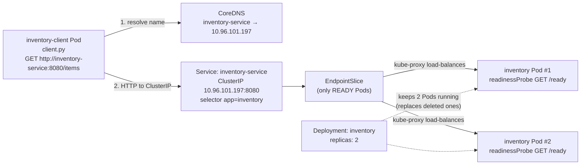
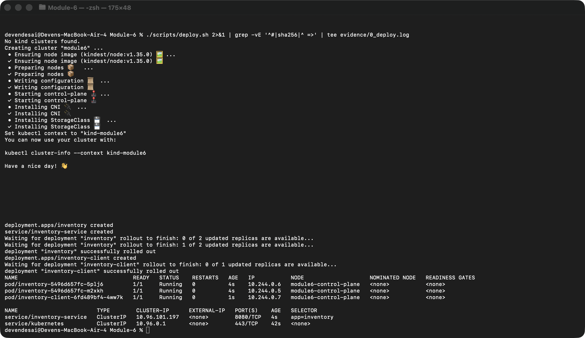
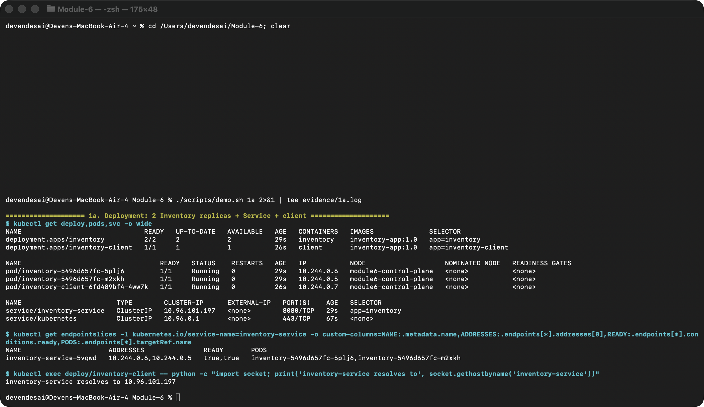
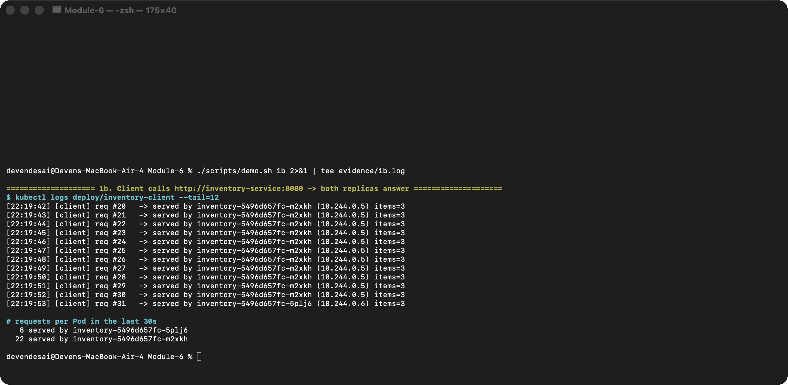
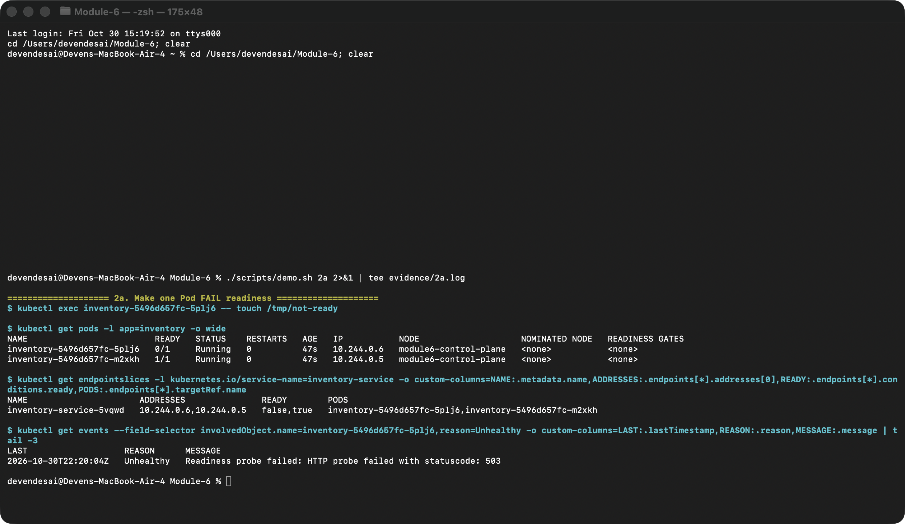
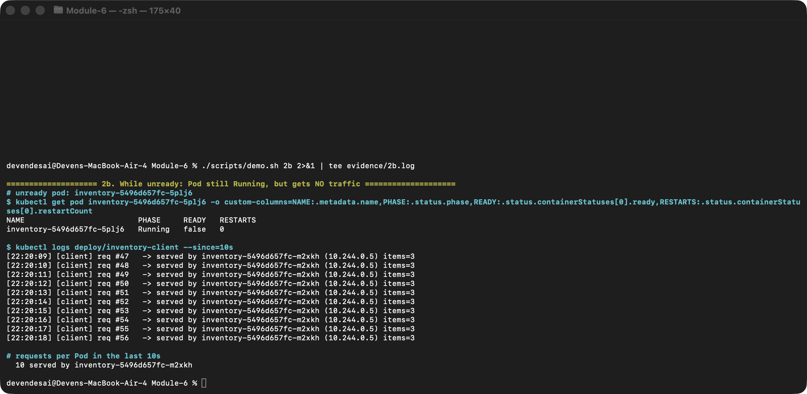
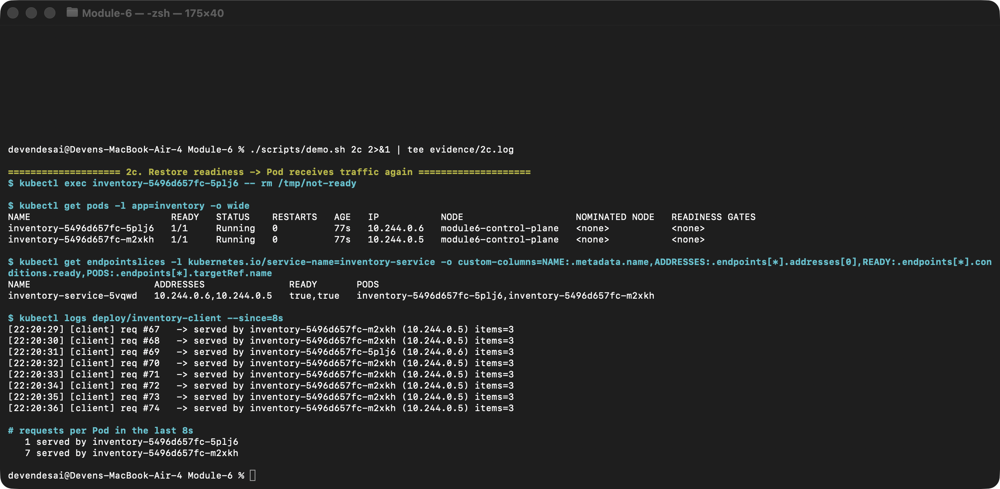
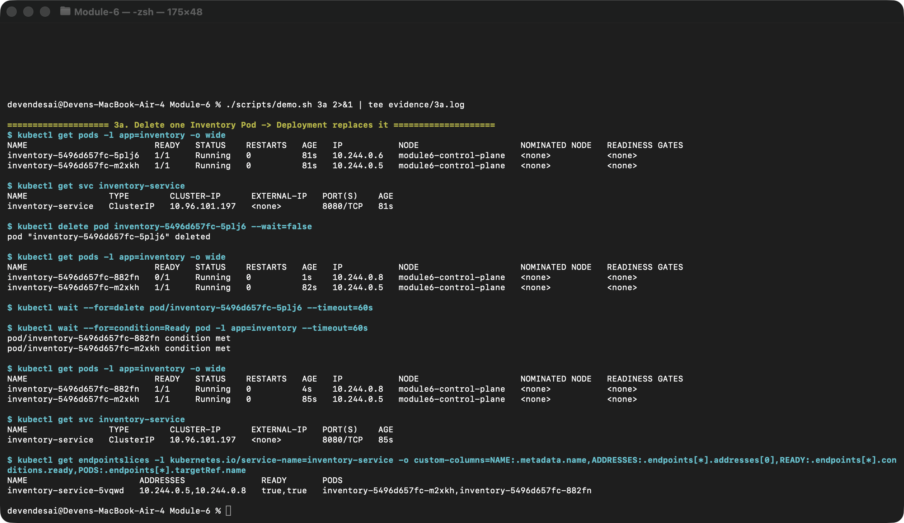
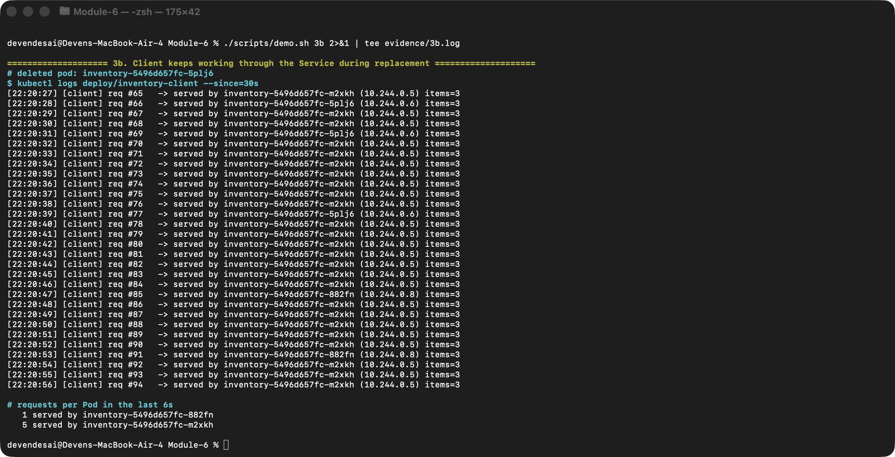

# Module 6 – Service Discovery, Readiness & Recovery on Kubernetes

A small **Inventory Service** runs on Kubernetes (local **kind** cluster) with **2 replicas** behind a **Service**. A **client** Pod calls the Service **by name** (`http://inventory-service:8080/items`) once per second and logs which Pod answered. The demo shows:

1. Both replicas run, the client reaches Inventory through the Service name, and both replicas receive requests.
2. A failing **readiness probe** takes one Pod out of rotation without killing it, and it rejoins once it's ready again.
3. A **deleted Pod** is replaced automatically under a new name, while the Service name (and ClusterIP) stays the same and the client keeps working.

## Repository layout

```
.
├── app/
│   ├── inventory.py          # Inventory HTTP service (/items, /ready, /healthz)
│   ├── client.py             # client that calls the Service by name every second
│   └── Dockerfile            # one image (inventory-app:1.0) used by both
├── k8s/
│   ├── inventory-deployment.yaml   # Deployment, replicas: 2, readiness + liveness probes
│   ├── inventory-service.yaml      # ClusterIP Service "inventory-service"
│   └── client-deployment.yaml      # client Deployment (1 replica)
├── scripts/
│   ├── deploy.sh             # create kind cluster, build + load image, apply manifests
│   └── demo.sh               # runs every scenario and prints the evidence
├── evidence/                 # raw logs of the run shown in the screenshots
└── screenshots/              # real Terminal screenshots of each step
```

## Architecture



Plain-text version:

```
                         ┌──────────────── Deployment "inventory" (replicas: 2) ────────────────┐
                         │                                                                       │
┌──────────────────┐     │   ┌──────────────────────┐        ┌──────────────────────┐            │
│ inventory-client │     │   │ inventory-…-xxxxx    │        │ inventory-…-yyyyy    │            │
│  client.py       │     │   │ readinessProbe /ready│        │ readinessProbe /ready│            │
└────────┬─────────┘     │   └──────────▲───────────┘        └──────────▲───────────┘            │
         │ http://inventory-service:8080 └──────────────┬───────────────┘                        │
         ▼                                              │ only READY Pods are endpoints          │
┌──────────────────────────────┐                        │                                        │
│ Service "inventory-service"  │────────────────────────┘                                        │
│ stable DNS name + ClusterIP  │  (EndpointSlice updated automatically as Pods change)           │
└──────────────────────────────┘                                                                 │
                         └───────────────────────────────────────────────────────────────────────┘
```

### How it works
* **Service discovery:** the client only knows the DNS name `inventory-service`. CoreDNS resolves it to the Service's ClusterIP, and kube-proxy forwards each new connection to one of the Service's **ready** endpoints. The client sends `Connection: close`, so every request is a new connection and gets load-balanced on its own.
* **Pod identity:** each Inventory Pod gets `POD_NAME`/`POD_IP` through the Downward API and returns them in every response. That's how the client log shows which replica answered.
* **Readiness probe:** `GET /ready` every 2 s (`failureThreshold: 1`). The endpoint returns **503** while the file `/tmp/not-ready` exists inside the container, so readiness can be broken and restored with `kubectl exec` without restarting the Pod.
* **Liveness probe:** `GET /healthz`, which always returns 200, so an unready Pod is *not* restarted. Readiness and liveness are deliberately independent.
* **Recovery:** the Deployment's ReplicaSet keeps 2 replicas, so a deleted Pod is immediately replaced by a new one with a new name and IP. The app handles `SIGTERM` so a deleted Pod shuts down promptly.

## Deploying

### Prerequisites
* Docker
* [kind](https://kind.sigs.k8s.io/) (`brew install kind`) and `kubectl`

Any local cluster works (minikube or Docker Desktop Kubernetes): build the image, make it available to the cluster, then `kubectl apply -f k8s/`.

### One command
```bash
./scripts/deploy.sh
```

### Manual steps
```bash
# 1. cluster
kind create cluster --name module6 --image kindest/node:v1.35.0

# 2. build the image and load it into the kind node
docker build -t inventory-app:1.0 app/
kind load docker-image inventory-app:1.0 --name module6

# 3. Inventory Deployment (2 replicas) + Service
kubectl apply -f k8s/inventory-deployment.yaml -f k8s/inventory-service.yaml
kubectl rollout status deployment/inventory

# 4. client
kubectl apply -f k8s/client-deployment.yaml

# 5. watch the client
kubectl get pods,svc -o wide
kubectl logs -f deploy/inventory-client
```

### Running the scenarios
```bash
./scripts/demo.sh            # all steps
./scripts/demo.sh 2a 2b 2c   # just the readiness test
```

Or do the same thing by hand:
```bash
kubectl exec <inventory-pod> -- touch /tmp/not-ready   # fail readiness
kubectl exec <inventory-pod> -- rm /tmp/not-ready      # restore readiness
kubectl delete pod <inventory-pod>                     # pod failure
```

### Cleanup
```bash
kind delete cluster --name module6
```

---

## Results and evidence

Every screenshot below is a real macOS Terminal window captured while the step ran. The text output of each step is in [`evidence/`](evidence/): [`0_deploy.log`](evidence/0_deploy.log), [`1a.log`](evidence/1a.log) … [`3b.log`](evidence/3b.log). The complete client log for the whole run is [`client_full.log`](evidence/client_full.log), and the server-side Inventory Pod logs are in [`inventory_pods.log`](evidence/inventory_pods.log).

### 0. Deployment

`./scripts/deploy.sh` creates the cluster, loads the image and applies the manifests. The two Inventory Pods and the client are `Running`.



### 1. Both Pods running, Service-name access, and both replicas receiving requests

**1a.** The Deployment is `2/2`, both Inventory Pods are `Running 1/1`, the Service `inventory-service` has ClusterIP `10.96.101.197`, and its EndpointSlice lists **both** Pods as ready. Inside the client Pod, the name `inventory-service` resolves (via cluster DNS) to that ClusterIP. The client is never given a Pod address.



**1b.** The client log shows responses coming from **both** replicas, `inventory-5496d657fc-m2xkh` (10.244.0.5) and `inventory-5496d657fc-5plj6` (10.244.0.6):



```
$ kubectl logs deploy/inventory-client
[22:19:24] [client] req #2    -> served by inventory-5496d657fc-m2xkh (10.244.0.5) items=3
[22:19:25] [client] req #3    -> served by inventory-5496d657fc-5plj6 (10.244.0.6) items=3
[22:19:26] [client] req #4    -> served by inventory-5496d657fc-5plj6 (10.244.0.6) items=3
...
# requests per Pod in the last 30s
   8 served by inventory-5496d657fc-5plj6
  22 served by inventory-5496d657fc-m2xkh
```

kube-proxy picks a ready endpoint at random for each new connection, so the split over a short window isn't exactly 50/50. What matters is that both replicas serve traffic through the one Service name. The server-side logs ([`inventory_pods.log`](evidence/inventory_pods.log)) confirm that each Pod logged `served /items to 10.244.0.7`, which is the client Pod's IP.

### 2. Readiness failure and recovery

**2a. Fail readiness on one Pod.** After `kubectl exec inventory-5496d657fc-5plj6 -- touch /tmp/not-ready`:
* the Pod is still `Running` but `READY 0/1`
* the EndpointSlice marks it `ready=false`
* the kubelet records `Readiness probe failed: HTTP probe failed with statuscode: 503`



**2b. The unready Pod gets no traffic, and the ready Pod keeps serving.** The Pod's phase is `Running` with `RESTARTS 0`, so it was **not** killed. It was only taken out of rotation. Every request in that window was served by the other Pod, `m2xkh`, with no errors:



```
NAME                         PHASE     READY   RESTARTS
inventory-5496d657fc-5plj6   Running   false   0

[22:20:09] [client] req #47   -> served by inventory-5496d657fc-m2xkh (10.244.0.5) items=3
...                                   (10 of 10 requests -> m2xkh)
[22:20:18] [client] req #56   -> served by inventory-5496d657fc-m2xkh (10.244.0.5) items=3

# requests per Pod in the last 10s
  10 served by inventory-5496d657fc-m2xkh
```

[`client_full.log`](evidence/client_full.log) shows that `5plj6` received **no requests between 22:20:01 and 22:20:24** (req #39–#62, all served by `m2xkh`). That's the window in which its readiness probe was failing.

**2c. Restore readiness.** After `kubectl exec inventory-5496d657fc-5plj6 -- rm /tmp/not-ready`, the Pod returns to `1/1`, the EndpointSlice shows `true,true` again, and `5plj6` serves requests again (`req #63`, `#66`, `#69`, `#77`):



```
[22:20:25] [client] req #63   -> served by inventory-5496d657fc-5plj6 (10.244.0.6) items=3
[22:20:28] [client] req #66   -> served by inventory-5496d657fc-5plj6 (10.244.0.6) items=3
[22:20:31] [client] req #69   -> served by inventory-5496d657fc-5plj6 (10.244.0.6) items=3
[22:20:39] [client] req #77   -> served by inventory-5496d657fc-5plj6 (10.244.0.6) items=3
```

### 3. Pod failure and recovery

**3a. Delete a Pod.** `kubectl delete pod inventory-5496d657fc-5plj6`. One second later the Deployment has already created a **replacement with a different name and IP**, `inventory-5496d657fc-882fn` (10.244.0.8). It goes from `0/1` to `1/1` once its readiness probe passes. The **Service name and ClusterIP are unchanged** (`inventory-service`, `10.96.101.197`, before and after). Only the EndpointSlice behind it changed, to `m2xkh` + `882fn`.



| | Before | After |
|---|---|---|
| Inventory Pods | `5plj6` (10.244.0.6), `m2xkh` (10.244.0.5) | `882fn` (10.244.0.8, **new**), `m2xkh` (10.244.0.5) |
| Service | `inventory-service` → `10.96.101.197:8080` | `inventory-service` → `10.96.101.197:8080` (**same**) |

**3b. The client keeps communicating through the Service.** The client log runs straight through the deletion with **no errors**. Requests go from `5plj6`/`m2xkh` to `m2xkh` alone and then to the new Pod `882fn` (`req #85`, `#91`). The client config never changed, because it only knows the Service name.



```
[22:20:39] [client] req #77   -> served by inventory-5496d657fc-5plj6 (10.244.0.6) items=3   <- old pod (deleted ~22:20:40)
[22:20:40] [client] req #78   -> served by inventory-5496d657fc-m2xkh (10.244.0.5) items=3
...
[22:20:47] [client] req #85   -> served by inventory-5496d657fc-882fn (10.244.0.8) items=3   <- replacement pod
[22:20:53] [client] req #91   -> served by inventory-5496d657fc-882fn (10.244.0.8) items=3
```

Shortly after this capture, the client log showed the two current replicas sharing traffic (`16 × 882fn`, `24 × m2xkh` over 40 s).

> In [`client_full.log`](evidence/client_full.log), the only error during the whole run is the client's **very first** request at startup (`Connection refused`), sent before kube-proxy had finished programming the brand-new Service. There were zero errors during the readiness test and the Pod replacement.

---

## Reflection

**Why is a stable Service name useful when Pods can fail or be replaced?**

Pods are disposable. In this lab, deleting `inventory-5496d657fc-5plj6` produced `inventory-5496d657fc-882fn` with a different name and a different IP, so any client that hard-coded a Pod address would have broken. The Service gives clients a stable DNS name and ClusterIP (`inventory-service` → `10.96.101.197`) that never changed, while Kubernetes keeps the list of real endpoints behind it up to date as Pods come, go, or fail readiness. This decouples *who* is calling from *which* instance answers: the client needs no reconfiguration, retries, or discovery logic of its own, and unhealthy or replacement Pods are added to or removed from rotation automatically. That makes scaling, rolling updates and self-healing invisible to callers, which is the point of service discovery.
